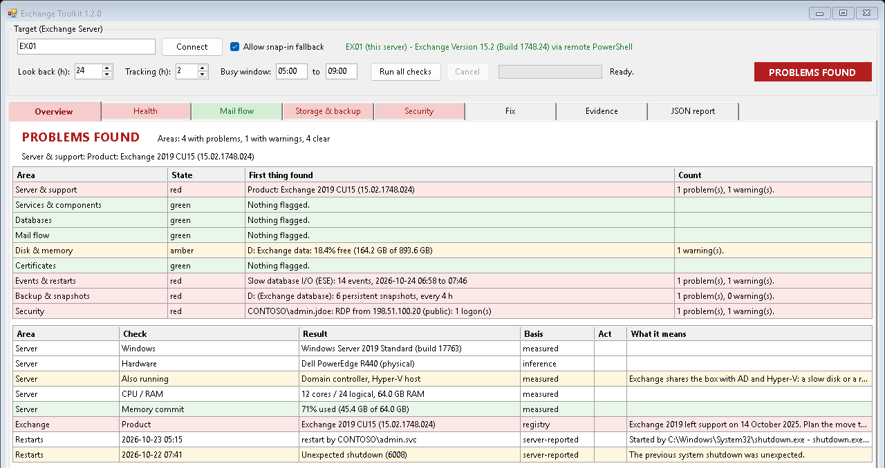

# Exchange GUI Tool: on-premises Exchange checks

A WinForms tool for **Windows PowerShell 5.1** for the on-premises Exchange Server that's "slow every morning", has "mail flow stopped", or keeps Outlook prompting. Run it on the server, or point it at one from a workstation. One click checks Exchange **and** the things the Exchange cmdlets can't see: snapshots on the database volume, backup filter drivers, the VSS writer, scheduled jobs inside the morning rush, event-log history and who's been trying passwords.

From [ihavenoram.com](https://ihavenoram.com): field notes for ADHD techs running managed services.



## Download

Grab **`exchange.zip`** from **[Releases](../../releases/latest)**. It holds one folder, `exchange\`, with only what runs: the scripts and a `.cmd` launcher for each. Copy that folder to the PC or server (for example `C:\temp\exchange`); this README and the docs stay here on GitHub. The SHA-256 checksum is in the release notes and in the `.sha256` file beside the zip:

```powershell
Get-FileHash .\exchange.zip -Algorithm SHA256
```

## Install it (recommended on a server you look after)

On the Exchange server, unzip it anywhere and double-click **`Install-ExchangeToolkit.cmd`**. It asks for admin rights, copies the tool to `C:\Scripts` (checking each copy against the original), and puts an **Exchange GUI Tool** shortcut on the all-users desktop, with its own icon and *Run as administrator* already set. Run it again to update.

If `C:\Scripts` already exists and isn't owned by Administrators or SYSTEM, the installer warns you and asks first: a folder a standard user owns lets them change scripts that admins later run elevated.

## Or just run it

Unzip it on the Exchange server (for example `C:\temp\exchange`) and double-click **`Launch-Exchange-Toolkit.cmd`**, elevated: VSS, shadow copies, the Security log and IIS need admin rights. Without them those checks say "needs an elevated session" rather than guessing, and a **Restart as administrator** button relaunches it.

It also works in **ScreenConnect Backstage** (running as SYSTEM). It goes straight to the Exchange management snap-in, checks this server only, and asks for your name before any action, so the action log says who did it.

## Why it exists

A single Exchange 2019 server, also the site's only domain controller, needed restarting every morning. Queues and back pressure looked healthy. It took two days of one-off commands to show the cause was on the **disk path**: EDR snapshots every 4 hours, "Previous Versions" snapshotting the database volume at 07:00, backup filter drivers in every disk write, a file-level backup agent copying the live `.edb`, and the Exchange VSS writer stuck on *Retryable error*. This tool puts those checks next to the Exchange ones, so the next case takes minutes.

## What it checks

| Tab | |
|---|---|
| **Overview** | A verdict per area (worst measured result, never a score), the server's roles, Exchange build and support status, recent restarts and what started them |
| **Health** | Services, components, databases, certificates, app pools, disk, memory, event-log retention, event signals over the look-back window, a disk-latency sample |
| **Mail flow** | Queues, back pressure, message-tracking throughput and latency, connectors |
| **Storage & backup** | Exchange-aware backups, VSS writers, shadow copies per volume, filter drivers, backup/snapshot products and overlaps, and a **schedule timeline** of every job flagged against your busy window |
| **Security** | Failed logins by source (SMTP AUTH, Windows, IIS), console and RDP logons, open ports against firewall rules |
| **Fix** | Start / stop / restart Exchange and IIS services, start every stopped automatic service, recycle app pools, IIS reset, and Microsoft's **HealthChecker** (downloaded and signature-checked) |
| **Evidence** | Export a time window of logs, tracking and IIS lines; start/stop a performance capture |
| **JSON report** | The full result, plus an **HTML report** for the client (summary and technical detail, client details optionally hidden) |

## How it behaves

- **It never invents an answer.** A check that couldn't run says why, and its area shows "not measured", never green. A **Basis** column says how each row was arrived at: measured, server-reported, registry or inference.
- **Checks never change anything.** Actions are separate: each shows its exact command, needs a confirmation (high-risk ones need the server name typed), and is written to `Output\Actions_<server>.log`. Service actions only reach Exchange, IIS and WinRM services.
- **Nothing leaves the server**, except the optional IP-location lookup, which lists the addresses and asks first.

## Files

| File | Purpose |
|---|---|
| `Launch-Exchange-Toolkit.cmd` | Launcher (forces `-STA`) |
| `Exchange-Toolkit.ps1` | The tool |
| `Launch-Exchange-Report.cmd` / `Generate-ExchangeReport.ps1` | Turn a saved JSON report into one self-contained HTML file (no admin or Exchange needed) |
| `Install-ExchangeToolkit.cmd` / `Install-ExchangeToolkit.ps1` | The installer: copies the tool to `C:\Scripts` and adds the desktop shortcut |
| `ExchangeToolkit.ico` | The shortcut's icon |
| `docs/TECHNICAL.md` | The full reference: every check, every action, what it can't see, and what has and hasn't been verified on a live server |

## Notes

- Windows PowerShell 5.1, no modules. Built and live-tested on Exchange 2019 (CU15).
- Reports, evidence packs and the action log go to `Output\` beside the scripts. They describe a real server.
- Some paths have only been tested offline so far (remote mode, the actions themselves, SYSTEM). [docs/TECHNICAL.md](docs/TECHNICAL.md) says exactly which.

## About

Built with AI assistance (Claude) from a real case. It's provided as is, with no warranty.

MIT licensed; see [LICENSE](LICENSE).
